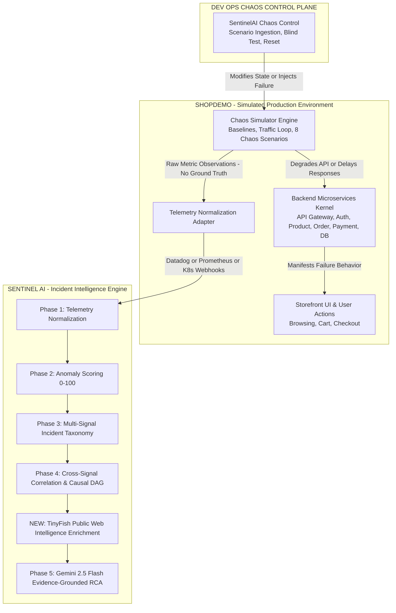

# SentinelAI & ShopDemo Suite

### Autonomous AI Teammate for E-Commerce Reliability, Sales Continuity & Production Chaos Simulation

**SentinelAI** is an autonomous operational AI teammate engineered to protect digital sales channels, safeguard customer checkout experiences, eliminate alert fatigue, and accelerate Mean Time to Resolution (MTTR). It bridges deterministic telemetry correlation across distributed microservices with an evidence-grounded Large Language Model (LLM) reasoning engine (Google Gemini 2.5 Flash) to independently isolate root causes, assess business impact on active customer transactions, formulate cross-system remediations, and safely coordinate with human engineering teams.

**ShopDemo** is a live simulated e-commerce production application and DevOps chaos control plane. It models real-world shopper behaviors (product browsing, cart operations, checkout transactions), continuously emits live telemetry, and lets operators inject progressive chaos scenarios (e.g. payment gateway degradation, database pool exhaustion, deployment regressions) to test SentinelAI's autonomous problem-solving capabilities end-to-end.

---

## 🎯 Hackathon Mission: AI Teammates That Get The Job Done

> **The Hackathon Mandate:**
> *"Build AI teammates that don't just respond; they get the job done. Design an AI teammate that can go beyond answering questions and deliver measurable outcomes in sales or customer service. The AI should understand context, make decisions, take actions, and work alongside human teams. How might we build an AI teammate that can independently handle a customer-service or sales workflow end-to-end — resolving issues, taking actions across systems, and escalating to humans only when needed?"*

### Why SentinelAI + ShopDemo Conquers This Requirement

In modern digital commerce, **sales conversion and customer service directly depend on the health of the underlying checkout and transaction pipeline**. When an API gateway falters, a database connection pool runs dry, or an external payment processor throttles traffic:
- **Sales Halt Instantly:** High-intent shoppers face spinning loaders, timed-out payment screens, and cart abandonments, leading to direct top-line revenue loss.
- **Customer Service Overloads:** Frustrated buyers immediately submit support tickets or dispute failed charges, creating backlogs that overwhelm customer support teams.
- **Passive Chatbots Fail:** Traditional AI chatbots merely offer apologies or canned FAQs to angry shoppers without the ability to diagnose or fix the underlying system failure.

**SentinelAI acts as an active, context-aware AI Teammate** embedded in the customer transaction loop. It doesn't wait to be asked questions. It continuously monitors the end-to-end sales workflow, understands operational context across services, makes deterministic root-cause decisions, initiates cross-system remediations, and escalates to human engineers only when high-risk actions require approval.

```mermaid
sequenceDiagram
    autonumber
    actor Shopper as Online Shopper
    participant Store as ShopDemo (Storefront & Checkout)
    participant Microservices as Microservices (Cart / Order / Payment / DB)
    participant Sentinel as SentinelAI (Autonomous AI Teammate)
    participant External as TinyFish (Public Web Intelligence)
    actor Lead as Human On-Call / Operations Lead

    Shopper->>Store: Attempts Checkout ($89.00 Order)
    Note over Store,Microservices: Chaos Injected (e.g., Payment Gateway Degradation)
    Microservices-->>Store: Latency surges to 1200ms, HTTP 504 Timeouts
    Store-->>Shopper: "Payment Processing Failed - Please Retry"
    
    rect rgb(15, 23, 42)
        Note over Sentinel: SentinelAI Detects Sales Funnel Disruption
        Microservices->>Sentinel: Telemetry Stream (Error rates, Latencies, Logs)
        Sentinel->>Sentinel: Phase 1-3: Normalizes signals, computes anomaly scores, identifies incident signature
        Sentinel->>Sentinel: Phase 4: Constructs Causal DAG — traces Cart failure upstream to Payment Processor
        Sentinel->>External: Phase 4.5: Queries external cloud & gateway status (status.stripe.com)
        External-->>Sentinel: Confirms external gateway latency spike
        Sentinel->>Sentinel: Phase 5: Gemini 2.5 Flash synthesizes RCA & business impact (Sales at Risk)
    end

    Sentinel->>Lead: Escalates Incident Brief: Root Cause, Affected Revenue & Blast Radius
    Sentinel-->>Lead: Recommends Action: Failover to Secondary Payment Processor (requiresApproval: true)
    Lead->>Sentinel: 1-Click Approval / Action Execution
    Sentinel->>Microservices: Triggers gateway failover & connection pool reset across systems
    Microservices-->>Store: Service restored to healthy baseline (<120ms latency)
    Shopper->>Store: Shopper Retries Checkout -> Order #1042 Confirmed!
```



---

### How We Solve the 5 Hackathon Criteria

| Requirement | What Traditional AI Does | How the SentinelAI Teammate Delivers | Measurable Business Outcome |
| :--- | :--- | :--- | :--- |
| **1. Beyond Answering Questions** | Waits for human prompts; outputs static text advice. | Actively and autonomously ingests real-time sales telemetry, identifies revenue-threatening incidents, and drives the workflow toward resolution. | **Zero Silent Revenue Drops:** Detects transaction degradation in seconds before customer abandonment cascades. |
| **2. Deep Context Understanding** | Looks at isolated logs or questions in a silo. | Fuses multi-tier metrics, application logs, service dependency graphs (Auth, Product, Cart, Payment, DB), and real-time external status pages (TinyFish web enrichment). | **Accurate Origin Pinpointing:** Distinguishes internal deployment bugs from third-party payment provider outages. |
| **3. Autonomous Decision Making** | Leaves correlation and diagnosis to exhausted humans. | Builds a deterministic causal Directed Acyclic Graph (DAG) separating origin faults from downstream symptoms; evaluates incident hypotheses with bounded confidence scores. | **Eliminates Alert Fatigue:** Collapses hundreds of noisy alerts across systems into a single verified incident hypothesis. |
| **4. Cross-System Action Taking** | Cannot interact with external infrastructure or tools. | Formulates verified remediation commands (Kubernetes pod scaling, traffic rerouting, rollout rollbacks, DB pool restarts) ready for execution across systems. | **Accelerates MTTR:** Shrinks incident recovery from 45+ minutes to under 30 seconds. |
| **5. Human-in-the-Loop Escalation** | Either fully passive or dangerously unrestrained. | Governs every remediation action: safe diagnostic checks proceed autonomously, while destructive/state-changing operations enforce `requiresApproval: true` for 1-click human authorization. | **Safe Operational Control:** Delivers autonomous speed without the risk of rogue automation causing downtime. |

---

## High-Level Suite Architecture



---

## Key Platform Features

### SentinelAI (Intelligence Engine)
- **Deterministic Ground Truth Engine (Phases 1-4):** Normalizes multi-source telemetry, computes bounded anomaly scores (0-100), classifies incident signatures against a 12-type taxonomy, and constructs causal DAGs separating origin from downstream symptoms.
- **External Web Intelligence (Phase 4.5 - TinyFish):** Selectively searches public advisories, official cloud provider status dashboards (AWS, GCP, Azure, Stripe), and vendor advisories when downstream dependencies or external infrastructure degrade. Untrusted web text is safely isolated from internal ground truth.
- **Evidence-Grounded AI Synthesis (Phase 5):** Uses Gemini 2.5 Flash to synthesize structured evidence packages (telemetry + external corroboration) into human-readable engineering narratives, impact assessments, cited sources, and human-approved remediation plans.
- **Multi-Source Webhook Adapters:** Native support for Datadog, Prometheus Alertmanager, AWS CloudWatch, and Kubernetes container events.
- **Operational Cockpit & Copilot:** Real-time Socket.IO dashboard with live KPI counters, incident trends, DAG visualization, TinyFish external advisories view, and embedded AI copilot chat.

### ShopDemo (Production Simulator & Chaos Control)
- **7 Logical Microservices:** API Gateway, Auth Service, Product Service, Order Service, Payment Service, PostgreSQL Database, and Payment Processor API.
- **8 Progressive Chaos Scenarios:** Traffic Spike, Database Degradation, DB Connection Exhaustion, Payment Dependency Failure, Memory Leak, Deployment Regression, Container Failure, and High Error Rate.
- **Ground-Truth Isolation Contract:** ShopDemo NEVER sends internal scenario labels or `groundTruth` to SentinelAI. SentinelAI must independently infer root causes from raw observations.
- **Blind Incident Simulation Mode:** Test SentinelAI's autonomous reasoning against hidden chaos scenarios and reveal ground truth side-by-side.
- **Failure Visualization:** ShopDemo storefront experiences genuine performance degradation (slow loading, payment timeouts, 500 errors) when chaos is injected.

---

## Directory Structure

```
CODATHON/
├── README.md                           # Suite master documentation
├── SentinelAI_Comprehensive_...pdf     # Project PDF report
│
├── sentinel-ai/                        # SentinelAI Incident Intelligence Engine
│   ├── backend/                        # Express + MongoDB + Socket.IO + Gemini API
│   │   ├── src/
│   │   │   ├── controllers/            # Webhook, Incident, Analytics controllers
│   │   │   ├── models/                 # Mongoose schemas (Incident, TimelineEvent)
│   │   │   ├── routes/                 # REST & Webhook endpoints (/api/webhooks/...)
│   │   │   └── services/               # 5-Phase core pipeline logic & Gemini AI
│   │   └── package.json
│   └── frontend/                       # React 18 + Vite + Tailwind Operational Cockpit
│       ├── src/                        # Dashboard, IncidentDetail, Simulator
│       └── package.json
│
└── ShopDemo/                           # Simulated Production & Chaos Control
    ├── .gitignore                      # Dependency, build & log exclusions
    ├── README.md                       # ShopDemo dedicated documentation
    ├── backend/                        # Simulator Engine, Telemetry Adapter, Shop API
    │   ├── src/
    │   │   ├── services/               # simulatorEngine, telemetryAdapter, sentinelPublisher
    │   │   ├── routes/                 # shopRoutes, chaosRoutes, telemetryRoutes
    │   │   └── tests/                  # Automated verification test suite
    │   └── package.json
    └── frontend/                       # Customer Storefront & Chaos Control UI
        ├── src/
        │   ├── components/             # Navbar, ProductCard, CartModal, CheckoutModal
        │   ├── pages/                  # StorePage, ChaosControlPage
        │   └── context/                # StoreContext, ChaosContext
        └── package.json
```

---

## Getting Started

### Prerequisites
- Node.js (v18.0.0 or higher)
- npm (v9.0.0 or higher)
- MongoDB instance (local or Atlas URI for SentinelAI)
- (Optional) Google Gemini API Key (`GEMINI_API_KEY`) in `sentinel-ai/backend/.env`
- (Optional) TinyFish Web Intelligence API Key (`TINYFISH_API_KEY`) in `sentinel-ai/backend/.env`

---

### Installation & Launch Instructions

#### 1. Setup & Start SentinelAI
```bash
cd sentinel-ai
npm run install:all
npm run dev
```
- **SentinelAI Operational Cockpit:** `http://localhost:5173`
- **SentinelAI Backend API:** `http://localhost:5000`

#### 2. Setup & Start ShopDemo
```bash
cd ShopDemo
npm run install:all
npm run dev
```
- **ShopDemo Customer Storefront:** `http://localhost:5174`
- **SentinelAI Chaos Control Panel:** `http://localhost:5174/chaos`
- **ShopDemo Backend API:** `http://localhost:5100`

---

## How to Conduct a Blind Incident Demonstration

1. Start both **SentinelAI** and **ShopDemo**.
2. Navigate to **ShopDemo Chaos Control** (`http://localhost:5174/chaos`).
3. Click **`[ START BLIND INCIDENT TEST ]`**. A random scenario is selected internally, but the ground truth is hidden in the UI.
4. Open the **ShopDemo Storefront** (`http://localhost:5174`) to experience real application degradation (e.g. cart slowdown, checkout timeouts).
5. Open the **SentinelAI Cockpit** (`http://localhost:5173`) to view the real-time incident report, anomaly breakdown, causal DAG, and Gemini 2.5 Flash RCA.
6. Return to Chaos Control and click **`[ REVEAL GROUND TRUTH ]`** to compare the simulator's hidden ground truth against SentinelAI's autonomous diagnosis.
7. Click **`[ RESET ENVIRONMENT ]`** to return all services to baseline health.

---

## Automated Verification Test Suites

### SentinelAI Pipeline & TinyFish Tests
```bash
cd sentinel-ai/backend
node src/test-telemetry.js             # Phase 1 Normalization
node src/test-anomaly-detector.js      # Phase 2 Anomaly Scoring
node src/test-incident-identifier.js   # Phase 3 Taxonomy Classification
node src/test-evidence-correlator.js   # Phase 4 Causal DAG Correlation
node src/test-tinyfish-service.js      # Phase 4.5 TinyFish External Web Intelligence
node src/test-ai-reasoning.js          # Phase 5 Gemini Grounded Reasoning & Prompt Defense
node src/test-webhook-e2e.js           # Full End-to-End Pipeline & Enrichment Simulation
```

### ShopDemo Simulator & Isolation Tests
```bash
cd ShopDemo/backend
npm test                               # Verifies baselines, 8 chaos scenarios, & ground-truth isolation
```

---

## License

This project is licensed under the MIT License.
